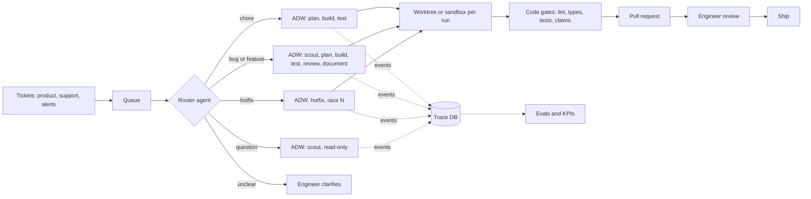
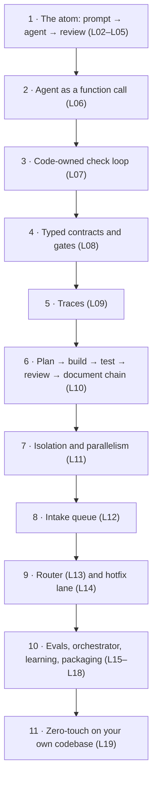

# 🏭 Software Factory Curriculum

> From prompting one agent to running a factory that turns tickets into reviewed, shipped code,
> built one station at a time.

**For:** software engineers who already ship production code (git, tests, CI, Python or
TypeScript) and are new to AI engineering. No ML background needed.

**Length:** 20 lessons in 6 levels, about 70 hours plus a 1–2 week capstone.

**By the end you can:**

- Design **AI Developer Workflows (ADWs)** where code owns sequencing, retries and acceptance, and
  agents own bounded phases.
- Run a **software factory**: tickets in → router → the right workflow → isolated runs →
  gated, reviewed pull requests out.
- **Measure and improve** it with traces and evals, not vibes.
- **Package** it so it can be stamped into any repository.

---

## How this curriculum works

1. **One practice repo, one growing factory.** You pick a small practice codebase in L01. Every
   lesson adds exactly one station to the factory around it. Nothing is thrown away.
2. **Build from the atom up.** The smallest unit is *prompt → agent → review*. Every later
   station is added only when a real problem calls for it.
3. **Three actors, placed on purpose.** Every step is owned by the **engineer**, an **agent**, or
   **code**. Code is the most reliable of the three: fast, free, deterministic. The rule: *if you
   can write the command down, it is code, not an agent.*
4. **Hand → Template → Code.** Each workflow is done by hand in a chat session first, then captured
   as a reusable prompt (a skill or slash command), then encoded in an ADW script. You never
   automate a workflow you have not run by hand.
5. **Measure from day one.** Every ticket goes in your logbook (see [The logbook](#the-logbook)).
   "Better" means a number moved.
6. **Level gates.** Each level ends with a gate. Do not move on until you pass it.

## Prerequisites

| You need | Why |
|---|---|
| A CLI coding agent with a headless mode. This curriculum uses **Claude Code** (`claude -p`); Codex CLI, Gemini CLI, pi or OpenCode work with small changes | Agents are the factory's workers |
| git, and optionally the GitHub CLI `gh` | Branches, worktrees, PRs |
| Python 3.12+ with `uv` (or Node/Bun if you prefer TypeScript for the factory) | ADW scripts |
| `sqlite3` | The trace database |
| Docker (optional, from Level 3) | Sandboxes |
| A budget: roughly $50–150 of model usage for the whole course | Every lab spends tokens, and you will learn to measure it |

---

## The destination

What you will have built by L18:

How it grows. Each step is the lesson that adds it:

## Roadmap at a glance

| Level | Lessons | You add to the factory | Loop position | Time |
|---|---|---|---|---|
| [0 · Orientation](#level-0--orientation) | L00–L01 | The mental model, the practice repo, the logbook | – | 4 h |
| [1 · In the loop](#level-1--in-the-loop) | L02–L05 | Reusable planning and closed-loop prompts | You watch every step | 13 h |
| [2 · Out of the loop](#level-2--out-of-the-loop) | L06–L10 | Headless agents, ADWs, contracts, gates, traces, the SDLC chain | You start it and review the result | 19 h |
| [3 · The factory floor](#level-3--the-factory-floor) | L11–L14 | Worktrees and sandboxes, intake queue, router, hotfix lane | You review PRs | 15 h |
| [4 · Scale and trust](#level-4--scale-and-trust) | L15–L18 | Evals, orchestrator agent, learning, packaging | You review the factory's metrics | 15 h |
| [5 · Capstone](#level-5--capstone) | L19 | Zero-touch engineering on your own codebase | You improve the factory | 1–2 weeks |

Every lesson below has the same parts: **Goal**, **Concepts**, **Steps**, **Done when**, and
**Sources** (the matching [Tactical Agentic Coding](https://agenticengineer.com/tactical-agentic-coding)
lesson, video chapter, or file in the reference factory).

---

## Level 0 — Orientation

### L00 · The software factory mental model

⏱ 1–2 h

**Goal:** explain what a software factory is, who does what inside it, and where you sit.

**Concepts**
- **Software factory:** the system of engineers, agents and code that turns intent into shipped,
  verified software, repeatably. Its job is to give you more leverage on every prompt.
- **Three actors:** engineer (planning and review), agent (reading, deciding, writing), code
  (everything deterministic). Ranked by reliability, code wins by miles.
- **The atom:** prompt → agent → review. Everything else is composed from it.
- **Agent proposes, code disposes.** Agents suggest; code validates, commits and decides "done".
- **Two layers:** the *application layer* (the product) and the *agentic layer* (the factory).
  Over this course your time moves from the first to the second.
- **Three loop positions:** in the loop (you watch every step) → out of the loop (you start it
  and review the result) → zero-touch (the factory ships; you watch its metrics).
- **Vibe coding vs. agentic engineering:** not knowing how your system works, versus knowing it
  so well you don't have to look.
- **Why "loop engineering" is the wrong unit:** a loop is just a condition inside a workflow. The
  unit of agentic work is the workflow (the ADW).

**Steps**
1. Watch [FORGET Loop Engineering. Agentic Engineering is about THIS](https://www.youtube.com/watch?v=VQy50fuxI34)
   end to end. Write down the build-up from atom to factory in your own words.
2. Watch [My Super Simple Software Factory](https://www.youtube.com/watch?v=haUfb1ievTE). Then read
   the *Why this exists* and *Three principles* sections of the
   [reference repo README](https://github.com/disler/super-simple-software-factory).
3. Draw your team's current SDLC as a Mermaid flowchart, from ticket to production.
4. Label every step **E**, **A** or **C** twice: who does it today, and who *should*.
5. List three steps you could hand to code tomorrow.

**Done when:** the diagram is in your logbook, and you can explain "agent proposes, code
disposes" to a colleague in two minutes.

**Sources:** Video *FORGET Loop Engineering*, 03:38 (three actors) and 17:48 (the software
factory) · TAC L1, L7, L8.

### L01 · Lab setup: your practice repo, backlog and logbook

⏱ 2–3 h

**Goal:** a safe workspace, a practice codebase with a realistic backlog, and a logbook.

**Steps**
1. **Install the tools** from [Prerequisites](#prerequisites). Run one headless call
   (`claude -p "say hi"`) to confirm auth works.
2. **Pick a practice repo.** It should be small (under about 2k lines), with one-command lint,
   type check and tests. A small web API is ideal. If you don't have one, generate one as your
   first agent exercise: write a one-paragraph spec (for example, "a bookmarks REST API with
   SQLite, pytest, ruff and strict mypy"), let the agent build it, and only review.
3. **Isolate it.** Give it its own directory and git repo, outside this course repo. Commit, then
   `git tag start` so you can always reset.
4. **Write a backlog** of about 14 tickets in `backlog/`, one markdown file each, written as
   symptoms and acceptance criteria rather than solutions. You need:
   - 2 chores, including one that makes the DB path and port configurable (L11 needs it)
   - 3 bugs
   - 5 features, including one large one with two halves that share a format (L16 needs it)
   - 1 production incident with a stack trace (L14)
   - 1 pure question (L13)
   - 1 deliberately vague request (L13)
5. **Plant real bugs without knowing where they are.** In a separate agent session, ask the agent
   to plant 3 realistic bugs the tests don't catch, commit them, and write symptom-only tickets.
   Don't read that diff. Now your bug tickets are real.
6. **Set safety rules for the whole course:**
   - Commit before every run.
   - Never give an agent production credentials.
   - Put a budget cap on every headless run (`--max-budget-usd`).
   - Only bypass permission prompts inside a sandbox.
7. **Start your logbook** (see [The logbook](#the-logbook)).

**Done when:** the four check commands pass on `start`, the backlog exists, and the logbook has
its header row.

---

## Level 1 — In the Loop

You sit in an interactive session for every step. The goal is to learn what agents need, before
you automate anything.

### L02 · Hello, agent: the atom

⏱ 3 h

**Goal:** ship tickets by prompting only.

**Concepts**
- An agent is a **model + tools + a loop**: think → call a tool → observe → repeat until done. The
  **harness** (Claude Code, Codex, …) supplies the tools, the context management and the
  permissions.
- **The core four:** context, model, prompt, tools. These are every lever you have on a single
  agent.
- **Review is your job.** Read the diff, run the checks, decide.

**Steps**
1. Adopt the rule for all of Level 1: **you write zero lines of application code.**
2. Ask the agent to explain the repo. Check its answer against reality.
3. Ship one bug ticket. Paste the ticket, watch the tool calls, read `git diff`, run the checks
   yourself, commit.
4. **Vague vs. precise.** Run a feature from a one-line prompt and note the result. Reset. Run it
   again with a four-line prompt:
   - Ask
   - Where
   - Done means
   - Out of scope

   Compare attempts.
5. **Change one of the core four.** Run the same ticket on a small model and a large model.
   Compare time, cost and quality.
6. Log attempts, presence and cost for every ticket.

**Done when:** 3 tickets are merged, you wrote zero lines by hand, and the logbook rows are filled.

**Sources:** TAC L1 *Hello Agentic Coding* · Video *FORGET Loop Engineering*, 04:43.

### L03 · See through the agent's eyes: context and leverage points

⏱ 3 h

**Goal:** make the repo easy for an agent to work in, and measure the difference.

**Concepts**
- The agent only knows what is in its context window. Your codebase speaks to it through
  **leverage points**:
  - *In the agent:* the core four.
  - *Through the codebase:* readable stdout and errors, types, docs, tests, consistent
    architecture, plans, templates, and later ADWs.
- **Memory file** (`CLAUDE.md`, `AGENTS.md`): commands, layout, conventions, definition of done.
  Keep it short. It is loaded on every call.
- **Context hygiene:** inspect (`/context`), reset between tasks (`/clear`), compact long sessions.
- **R&D — Reduce and Delegate:** load less, and send searches to subagents that return summaries.

**Steps**
1. Ask the agent what slowed it down in L02. Audit the repo against the leverage-point list.
2. Write a memory file of 60 lines or fewer.
3. Add a one-command `check` script whose failure output says exactly what failed and where.
4. Add `ai_docs/` with docs for any library the agent got wrong.
5. **Delegate.** Ask the agent to use a subagent for a codebase-wide search. Compare `/context`
   before and after.
6. Run a fresh bug ticket in a new session and compare its KPIs with L02.

**Done when:** your logbook shows fewer attempts per ticket than in L02.

**Sources:** TAC L2 *The 12 Leverage Points* and L9 *Elite Context Engineering*.

### L04 · Success is planned: specs and reusable prompts

⏱ 4 h

**Goal:** turn planning into a reusable, parameterized prompt that produces specs you can review.

**Concepts**
- The plan is where your engineering judgment lives. It is the first of your two constraints;
  review is the second. Fixing a plan is far cheaper than fixing code.
- **The prompt ladder:** ad-hoc prompt → saved prompt → parameterized template → prompt that
  produces an artifact → meta-prompt (a prompt that writes prompts).
- **Skills and slash commands** (`.claude/skills/<name>/SKILL.md` with `$ARGUMENTS`) are how
  templates get reused.
- **One template per class of work.** A bug plan reproduces the bug, finds the root cause, fixes
  it and adds a regression test. A feature plan is shaped differently.

**Steps**
1. **By hand.** Write a spec yourself for one feature. Use these sections:
   - Problem
   - Solution
   - Relevant files
   - Step-by-step tasks
   - Acceptance criteria
   - Validation commands
   - Out of scope

   Hand the spec to the agent to implement.
2. **Template it.** Create `/chore`, `/bug` and `/feature` skills. Each one reads a ticket and
   writes `specs/<id>-<slug>.md` from its class template.
3. Create `/implement <spec-path>`.
4. Run *plan → read and edit the spec → `/clear` → implement* on 2 tickets.
5. **Stretch:** a meta-prompt skill that writes a new planning template for a class of work.

**Done when:** 2 tickets are shipped plan-first, and their specs are committed in `specs/`.

**Sources:** TAC L3 *Success is Planned* and L10 *Agentic Prompt Engineering*.

### L05 · Close the loop: self-validation

⏱ 3 h

**Goal:** the agent validates its own work and iterates until green. You touch only the plan and
the final review.

**Concepts**
- **Open loop:** the agent writes code and stops, so you are the test runner.
  **Closed loop:** request → validate → resolve, repeated until valid.
- **Feedback sources:** tests, linters, type checkers, running the app, logs, screenshots.
- **More compute, more confidence.** Tokens spent validating are cheap next to your time.
- **Reward hacking:** an agent may weaken a test to make it pass. Watch test diffs.

**Steps**
1. Make *Validation commands* a required section in every spec template.
2. Upgrade `/implement`: run validation, fix, repeat up to N times, then report the evidence.
3. Add an end-to-end check skill. It starts the app and exercises each acceptance criterion.
4. Ship one feature with exactly two touches: approving the plan and reviewing the result.
5. Look for weakened tests. Add a rule to the memory file and review every test diff.

**Done when:** a feature ships with two touches.

**Sources:** TAC L5 *Close The Loops*.

> **🚧 Level 1 gate:** ship a bug, a feature and a chore, each with at most 2 touches. At least
> 2 of the 3 must succeed on the first attempt after you approve the plan.

---

## Level 2 — Out of the Loop

The loop moves out of your chat window and into code. From here on, the factory is software, and
you build it the way you build software.

### L06 · Headless agents: the agent as a function call

⏱ 3 h

**Goal:** call agents from scripts and get structured, resumable results.

**Concepts**
- **Headless mode** (`claude -p`) turns an agent into a function call with a non-deterministic
  body. That is exactly why contracts and gates come next.
- **What comes back:** `--output-format json` returns `result`, `session_id`, `total_cost_usd`
  and `is_error`.
- **Structured output:** `--json-schema` returns schema-valid output in `structured_output`.
- **Continuing:** `--resume <session_id>` picks up the same context window.
- **Unattended permissions:** a permission mode plus an allowlist of tools. Budget caps on every
  call.
- **PITER**, TAC's checklist for away-from-keyboard agents: **P**rompt **I**nput, **T**rigger,
  **E**nvironment, **R**eview. You need all four before you can leave.
- **One adapter:** exactly one module in your factory knows how to talk to the harness. Swap it,
  and the factory runs on a different agent.

**Steps**
1. Make a headless call with JSON output and inspect every field with `jq`.
2. Request structured output with a small JSON Schema.
3. Capture the `session_id` and send a follow-up with `--resume`.
4. **Write the adapter:** `run_agent(AgentCall) -> AgentResult`.
   - `AgentCall` holds: role, prompt, model, allowed tools, system prompt, schema, session id,
     budget, working directory.
   - Save the raw output of every call under `runs/<run_id>/`.
5. Write `adw_prompt`: a CLI for one agent and one prompt. Run a ticket while you're away, then
   review only the diff.

**Pitfalls**
- **Stdin wait:** pass the prompt on stdin, or redirect stdin. Otherwise the CLI waits a few
  seconds for piped input on every call.
- **Cumulative cost:** `total_cost_usd` on a resumed session includes earlier spend. Account for
  the difference, or you will double-count.
- **Your settings leak in:** headless runs load your user-level hooks and settings, which hurts
  reproducibility. `--setting-sources` and `--bare` control this (`--bare` requires an API key).
- **Silent denials:** in headless mode, a tool missing from the allowlist is denied without a
  prompt. If the allowlist is too narrow, the agent can't run its own tests. That is one more
  reason checks belong in code (L07).

**Sources:** TAC L4 *AFK Agents* · [Claude Code headless docs](https://code.claude.com/docs/en/headless).

### L07 · Your first ADW: code owns the loop

⏱ 4 h

**Goal:** builder → code runs the checks → failures go back to the same builder session, a
bounded number of times.

**Concepts**
- Move the loop from the prompt (L05) into code. The result is deterministic, cheaper (no tokens
  spent running tests), bounded, and gives a definition of done the agent can't argue with.
- **Phases** have a name, a kind (*engineer*, *agent* or *code*), an owner and a status. Every
  phase starts as failed, and success must be earned.
- **Same-session correction vs. cold restart.** Resuming keeps everything the agent just learned.
- **A phase succeeding is not the run being accepted.** A check phase that ran a red suite did its
  job, but the run must not pass.

**Steps**
1. Sketch the workflow in Mermaid. Then run it once **by hand**: prompt the agent, run the checks,
   paste the failures back.
2. Write a `quality` module that runs each check command and returns pass/fail plus the tail of
   its output.
3. Write a `Run` + `phase()` primitive that records status, duration and owner for every phase.
4. Write `adw_build_test`:
   - build → checks → fix (resume) → checks → …
   - at most 3 fixes
   - exit code = accepted or not
5. Provoke the fix loop with a ticket likely to fail type checks.

**Pitfalls**
- **Off-by-one:** an off-by-one in the loop means the last fix is never re-checked.
- **Validate inputs in code before spawning an agent.** Given a ticket path that didn't exist, an
  agent guessed the task from the filename and shipped a fix for it.
- **Mixed environments:** the ADW's own environment variables (a virtualenv, for example) can leak
  into the app's check commands.
- **Commit the factory code before running it.** Your gates compare against git.

**Sources:** Video *FORGET Loop Engineering*, 06:02 and 07:35 · Reference repo
`adws/adw_build_test.py`.

### L08 · Contracts: envelopes and gates

⏱ 4 h

**Goal:** typed handoffs between agents, and gates that verify what agents claim.

**Concepts**
- **Envelope:** the typed shape of an agent's final answer. Think of it as a DTO.
  - Base fields: `status`, `summary`, `artifacts`, `notes_for_next_agent`.
  - Per-role fields: `changed_files`, `approved`, `findings`, `commit_message`.
  - Its schema is what you pass to `--json-schema`.
- **Gates verify claims after the fact, never predictions.** Examples: declared artifacts exist;
  claimed changed files match `git status`; a review's verdict is consistent with its findings;
  tests pass.
- **A violation becomes a correction** sent to the same session, a bounded number of times.
- **Agent proposes, code disposes.** The builder *proposes* a commit message, and *code* commits.
- **The synced triad:** the type, the JSON example in the prompt, and the call site are one
  contract. Change one, change all three.

**Steps**
1. Define envelopes for plan, build, review and doc.
2. Write 4 gates, and unit-test them with fake envelopes. This is plain software engineering.
3. Add `run.call(call, output_type, gates)` with the correction loop.
4. Add a code-owned commit phase.
5. Ship a feature, and find a gate violation that was corrected in-session.

**Done when:** your gate tests pass, and a run log shows a violation corrected in the same
session.

**Sources:** Reference repo `references/handoff.md`, `adw_modules/gates.py`,
`adw_modules/data_types.py`.

### L09 · Observability: trace every run

⏱ 3 h

**Goal:** every run leaves a queryable trace of phases, tool calls, tokens, cost and duration.

**Concepts**
- If you can't measure your agents, you can't improve them. Debugging a factory means reading
  traces, not transcripts.
- **Files are the raw record; the database is the queryable mirror.**
- **A minimal data model:** runs, phases, events, envelopes, gate results.
- **Live events:** `--output-format stream-json --verbose` streams every tool call as it happens.
  Hooks are an alternative telemetry source.
- **Metrics to watch:** cost per phase, retries per phase, gate-failure rate, wall time.

**Steps**
1. Write a SQLite tracer (WAL mode, so reads never block a running workflow).
2. Switch the adapter to streaming, and record each tool call as an event.
3. Add query commands: `runs`, `phases <run_id>`, `tail <run_id>`.
4. Run 3 tickets. Answer "which phase cost the most, and why?" with one query.
5. **Stretch:** a small web or TUI viewer. Compare yours with the reference repo's visualizer.

**Sources:** Reference repo `references/observability.md` · TAC L12 (real-time observability).

### L10 · The SDLC chain: plan → build → test → review → document → ship

⏱ 5 h

**Goal:** one command takes a ticket to reviewed, documented commits.

**Concepts**
- **One agent, one prompt, one purpose.** Planner, builder, reviewer and documenter are agents.
  Testing is code.
- **Tests and review answer different questions.** Tests ask "does it run?" The reviewer asks
  "is this what was asked for?", against the spec. Neither can answer the other's question.
- **Agent roster config.** Each agent gets its own model, prompt files, tools and write boundary.
  ADW scripts name agents, never models.
- **Prompt files:** the system prompt holds identity; the user prompt holds the task and the
  output shape.
- **Commit per work product.** The plan, the code and the docs each get their own commit. Code is
  committed only after it is verified.

**Steps**
1. Write the roster config.
2. Port your L04 and L05 skills into system and user prompt files. This is *hand → template →
   code* in action.
3. Write `adw_sdlc` with bounded fix and revise loops. Re-run the tests whenever a revision
   changed code.
4. Run a feature end to end while you're away. Review only the branch and the trace.
5. **Experiment:** put the reviewer on a different model, and compare the two runs in the trace.

**Done when:** one command produces three commits (plan, code, docs) for a feature.

**Sources:** TAC L6 *Let Your Agents Focus* · Reference repo `adw_simple_sdlc.py`,
`references/config.md`.

> **🚧 Level 2 gate:** one command ships a feature ticket. You were present only at the start and
> the end, and the trace explains every dollar spent.

---

## Level 3 — The Factory Floor

### L11 · Isolation and parallelism: worktrees → sandboxes

⏱ 4 h

**Goal:** each run works in its own worktree and branch, so runs can safely go in parallel, and
write boundaries are enforced.

**Concepts**
- Without isolation, parallel runs collide and an agent can touch anything.
- **Worktree per run:** a git worktree on its own branch, with its own ports and database path.
- **Sandboxes:** containers, devcontainers or cloud sandboxes. A sandbox is the only place to
  bypass permission prompts.
- **Tools are a capability list; writes are a boundary.** `bash` can do anything, so "this agent
  changes nothing" must be enforced in code. After every call, snapshot the tree, compare, roll
  back unauthorized changes, and fail the phase.

**Steps**
1. Ship your "configurable DB path and port" chore **through your own factory**. You need it for
   parallel runs.
2. Add a worktree module and an `--isolated` flag to your ADWs. Run records stay in the main repo.
3. Enforce write boundaries:
   - a `writes` allowlist per agent
   - protected paths, such as the factory itself

   Test it by asking the reviewer to edit code.
4. Run 3 tickets in parallel.
5. Add a merge step: a PR via `gh`, or a local branch plus a summary.
6. **Stretch:** run the builder inside a container.

**Pitfall:** agents edit files the task never mentioned. In testing, a builder fixing an API bug
also edited `.gitignore`. The write boundary is what catches this.

**Sources:** Video *FORGET Loop Engineering*, 10:40 · Reference repo README, *Where it can still
fail*.

### L12 · Intake: tickets in, pull requests out

⏱ 4 h

**Goal:** the factory pulls work from a queue, runs it, and reports back.

**Concepts**
- **PITER applied:**
  - Prompt input: the ticket
  - Trigger: a poll, webhook, label or cron
  - Environment: a worktree or sandbox
  - Review: a PR
- **Queue states:** ready → in progress → review → done or failed. An atomic claim works as a
  lock. Make intake idempotent.
- **Every agent reads the ticket.** Normalize it into the four-line shape first, keeping the
  requester's intent and exact words.
- **Scout agent:** read-only recon before planning. It finds files, docs and past specs.
- **Untrusted tickets are a prompt-injection channel.** Only maintainers can trigger runs, runs
  happen in a sandbox, and the factory holds no secrets.

**Steps**
1. Build a file-based kanban: one folder per state.
2. Write `factory watch`: poll, claim, launch an ADW, move the ticket to review or failed, and
   record the run id.
3. Add a normalizer phase.
4. Add a scout phase before the planner.
5. **GitHub variant:** issues trigger runs by label; the factory comments with the run id and
   opens a PR.
6. Load 3 tickets, walk away, and come back to 3 branches or PRs.

**Sources:** TAC L4 · Video *FORGET Loop Engineering*, 11:56 · Reference repo
`cookbooks/how_to_prompt_for_the_eng.md`.

### L13 · The factory router

⏱ 3 h

**Goal:** send each ticket to the right workflow and model tier, and measure how accurately you
route.

**Concepts**
- **Work classes:** chore, bug, feature, hotfix, question, unclear. Each maps to a workflow, a
  model tier and a budget.
- **Router:** a classifier agent with an enum output plus confidence. The dispatch table lives in
  code.
- **Code-first routing:** an explicit label skips the agent entirely. If confidence is low, the
  ticket goes to the engineer.
- **The router is a model, so evaluate it:** accuracy and a confusion matrix on labeled tickets.

**Steps**
1. Write a routes config: class → ADW, model, budget, retries.
2. Write the router agent on a small, cheap model.
3. Add code-first label routing.
4. Label about 18 tickets, with ids stripped, and write an eval that prints accuracy and a
   confusion matrix.
5. Wire the router into intake.

**Done when:** routing is at least 90% accurate on your set, questions never change code, and
unclear tickets always reach you.

**Sources:** Video *FORGET Loop Engineering*, 17:48 (factory router).

### L14 · Incident response: the hotfix lane

⏱ 4 h

**Goal:** a predefined hotfix ADW that races N attempts in parallel and ends in your approval.

**Concepts**
- In a crisis there is no time to craft prompts, so the workflow must already exist.
- **Hotfix agent:** fix fast, not elegantly. Minimal diff, plus a regression test.
- **Reproduce first:** turn the alert into a failing test before fixing anything.
- **Best-of-N:** N builders in N sandboxes. The first green result wins and the others are
  cancelled.
- **Close the incident properly:** an engineer approval phase, then a follow-up ticket for the
  proper fix and a postmortem written by the documenter.

**Steps**
1. Recreate your planted incident, for example with data that crashes a production code path.
2. Add alert intake: a simulated webhook or a file drop.
3. Write `adw_hotfix`:
   - scout reproduces the failure
   - N parallel hotfix builders
   - gates
   - first green wins
   - engineer approval
   - merge
   - postmortem and follow-up ticket
4. Measure time-to-fix. Compare N=1 against N=3 on cost and time.

**Sources:** Video *FORGET Loop Engineering*, 15:27 (production goes down).

> **🚧 Level 3 gate:** drop 5 mixed tickets into *ready* and walk away for an hour. Come back to
> correctly routed, isolated, gated results, with at most one failure, and that failure explained
> by the trace.

---

## Level 4 — Scale and Trust

### L15 · Evals: measure the factory before you change it

⏱ 4 h

**Goal:** a regression suite for your factory, so every change to a prompt, model or workflow is
measured before you adopt it.

**Concepts**
- The factory is software, so it needs tests. A prompt change is a code change.
- **Golden tickets:** a base commit, a ticket, and hidden acceptance tests the agent never sees.
- **Metrics:** pass rate, cost, time, retries, human interventions. Agents are
  non-deterministic, so run each case k times.
- **LLM-as-judge** for qualities a predicate can't check, such as spec or review quality.
  Calibrate it against your own labels first.
- **The four KPIs:** attempts ↓, size ↑, streak ↑, presence ↓.

**Steps**
1. Write 5–6 golden tickets. Store their hidden tests outside the repo the agent works in.
2. Write the eval harness: create a worktree at the base commit, run the ADW, copy in the hidden
   tests, run them, record the results.
3. Produce a scoreboard.
4. Change one thing (a model or a prompt) and compare, with k=2.

**Done when:** you accept or reject a factory change based on numbers.

**Sources:** TAC KPIs · Reference repo README, *Gates pass, output is bad*.

### L16 · Multi-agent orchestration

⏱ 4 h

**Goal:** an orchestrator agent operates the factory, and you use fan-out deliberately, only when
the numbers say so.

**Concepts**
- **Orchestrator:** an agent whose tools are your factory: launch, status, kill. It never does the
  work itself.
- **The spine:** goal → decompose → spawn (isolated context) → contract → barrier → merge →
  verify.
- **Patterns you already built:** pipeline (L10), router (L13), best-of-N (L14),
  evaluator-optimizer (the review loop). New here: **fan-out / fan-in**.
- **Two kinds of multi-agent:** subagents inside a harness, or agents as processes in your code.
  Know when to use which.
- **When NOT to go multi-agent:** coordination overhead, context fragmentation, cost. Prefer one
  agent plus code until a measured problem says otherwise.

**Steps**
1. Write an orchestrator skill: hard rules plus commands mapped to your factory CLI. Drive a whole
   batch from chat.
2. Write a fan-out ADW for your large two-part feature:
   - the planner defines the shared contract
   - 2 builders work in parallel worktrees
   - barrier, merge, integration tests, review
3. Eval it against a single-builder baseline.

**Sources:** TAC L12 *Multi-Agent Orchestration* · Reference repo `SKILL.md` (orchestrator rules)
· This repo's [multi-agent-orchestration/](multi-agent-orchestration/MAP.md) outline (see
[How this repo fits together](#how-this-repo-fits-together)).

### L17 · Agents that learn

⏱ 3 h

**Goal:** the factory builds up knowledge, and proposes improvements to itself that evals must
approve.

**Concepts**
- Agents are stateless, so learning has to be written down. **Expertise files** per domain:
  act → learn → reuse.
- The documenter's output feeds future planners.
- **Failure mining:** recurring gate failures in the trace point to missing knowledge.
- **The improver meta-ADW:** it proposes a prompt diff, the eval decides, and you approve. Cap the
  size of expertise files so they don't bloat the context.

**Steps**
1. Add a learn phase that updates expertise files after each run.
2. Have the planner load the relevant expertise.
3. Write an improver ADW: read the last N failed runs, propose a prompt change, run the eval, open
   a PR.

**Done when:** one improvement is accepted on eval evidence.

**Sources:** TAC L13 *Agent Experts*.

### L18 · Package the factory

⏱ 4 h

**Goal:** a factory you can install in any repo, on any harness.

**Concepts**
- **The skill is the product.** A `SKILL.md` with hard rules and request routing, cookbooks,
  templates, and an install script that stamps the factory into a repo. A re-runnable install
  doubles as a drift check.
- **Plugins** distribute it to a team.
- **Harness adapters:** CLI, Agent SDK, other agent CLIs, all behind one interface.
- **Agent SDK for domain-specific agents:** custom tools, hooks as guardrails, structured output.
- **CI triggers:** for example, a GitHub Action that fires on a label.

**Steps**
1. Restructure the factory into a skill with an install script.
2. Add a second adapter (Agent SDK) for one role. For example, a reviewer with read-only custom
   tools and a hook that denies writes.
3. Install it into a second repo, ideally your real project, and wire in its **real** check
   commands. Placeholder checks that always exit 0 make the test phase theater.
4. **Optional:** a GitHub Action trigger.

**Done when:** a fresh install reaches its first green run in under 30 minutes.

**Sources:** Reference repo README, *The skill is the product* · TAC L11 *Building
Domain-Specific Agents* · [Agent SDK docs](https://code.claude.com/docs/en/agent-sdk/python).

> **🚧 Level 4 gate:** show an eval-backed before/after for one factory change, and install the
> factory into a second repo.

---

## Level 5 — Capstone

### L19 · Zero-touch engineering on your own codebase

⏱ 1–2 weeks

**Goal:** zero-touch engineering for at least one class of work on a real codebase.

**Steps**
1. Pick one work class, such as dependency bumps, chores or small bugs.
2. Define auto-merge criteria:
   - every gate passes
   - the reviewer approves
   - the eval pass rate is at least X%
   - the diff is at most N lines
   - no protected path is touched
   - the run stays within budget
3. Run at least 20 tickets and collect the KPIs.
4. Write `FACTORY.md`:
   - architecture diagram
   - agent roster
   - workflows and routes
   - gates
   - KPIs
   - known failure modes
   - next investments
5. Present it to your team.

**Graduation:** at least one work class merges with no human touch. Your KPIs show presence
falling and size rising across the course. You can explain every phase of your factory: who
owns it, why, and what it costs.

**Sources:** TAC L7 *ZTE*, L8 *The Agentic Layer*, L14 *The Codebase Singularity*.

---

## Pacing

About 7–8 hours a week:

| Week | Lessons |
|---|---|
| 1 | L00–L03 |
| 2 | L04–L05, Level 1 gate |
| 3 | L06–L08 |
| 4 | L09–L10, Level 2 gate |
| 5 | L11–L12 |
| 6 | L13–L14, Level 3 gate |
| 7 | L15–L16 |
| 8 | L17–L18, Level 4 gate |
| 9–10 | L19 capstone |

## The logbook

Keep one row per ticket from L02 onward. The trace database (L09) fills most of these columns for
you.

| Date | Ticket | Lesson | Method (prompt / skill / ADW) | Attempts | Size | Presence (min) | Wall time | Cost | One-shot? | Notes |
|---|---|---|---|---|---|---|---|---|---|---|

- **Attempts:** prompts or runs until done. *Down is better.*
- **Size:** how much work one prompt or run delivers (files, acceptance criteria). *Up is better.*
- **Streak:** consecutive one-shot successes. *Up is better.*
- **Presence:** minutes you spent in the loop. *Down is better.*

## Glossary

| Term | Think of it as |
|---|---|
| **Agent** | A non-deterministic function with tools: model + tools + loop |
| **Harness** | The runtime around the model (Claude Code, Codex CLI, …); like a VM for the agent |
| **Core four** | The agent's configuration surface: context, model, prompt, tools |
| **ADW** (AI Developer Workflow) | A build script or CI pipeline whose steps can be agents |
| **Phase** | One step in that pipeline, owned by the engineer, an agent or code |
| **Envelope** | A DTO or API contract for an agent's output |
| **Gate** | An assertion or CI check that verifies an envelope's claims |
| **Agent roster** | Service configuration or dependency injection for agents |
| **Trace** | Distributed tracing for agent runs |
| **Worktree / sandbox** | An ephemeral environment or container per run |
| **Router** | A dispatcher: a classifier plus a dispatch table |
| **Agentic layer** | The factory: everything in the repo that builds the product |
| **Zero-touch engineering (ZTE)** | Continuous deployment, for a class of work, end to end |

## Sources

- **Tactical Agentic Coding**, IndyDevDan: [course page](https://agenticengineer.com/tactical-agentic-coding)
  (lessons 1–8 plus *Agentic Horizon* 9–14). This curriculum follows the same skills in a
  different order, built around one factory you grow lesson by lesson.
- **Video:** [My Super Simple Software Factory (For Agentic Engineers)](https://www.youtube.com/watch?v=haUfb1ievTE).
- **Video:** [FORGET Loop Engineering. Agentic Engineering is about THIS](https://www.youtube.com/watch?v=VQy50fuxI34).
- **Reference factory:** [disler/super-simple-software-factory](https://github.com/disler/super-simple-software-factory)
  (MIT). Read it *after* you build each piece yourself, and compare. Its `example` branch shows
  the factory stamped into a demo app.
- **Claude Code docs:** [headless mode](https://code.claude.com/docs/en/headless) ·
  [skills](https://code.claude.com/docs/en/skills) ·
  [Agent SDK (Python)](https://code.claude.com/docs/en/agent-sdk/python).

## How this repo fits together

- **`README.md`:** the course overview. Its roadmap points here.
- **`CURRICULUM.md`** (this file): the full path, from beginner to advanced.
- **`multi-agent-orchestration/`:** an earlier outline that teaches orchestration through three
  vehicles: prompt, role files, code. Its lessons are still empty headings.
  - It is an *advanced deep-dive*. It belongs after **L16**, not at the start of the course.
  - Its three vehicles are the same idea as this curriculum's *hand → template → code*
    principle.
  - Its "spine" (decompose → spawn → contract → barrier → merge → verify) is the core concept
    of L16.
